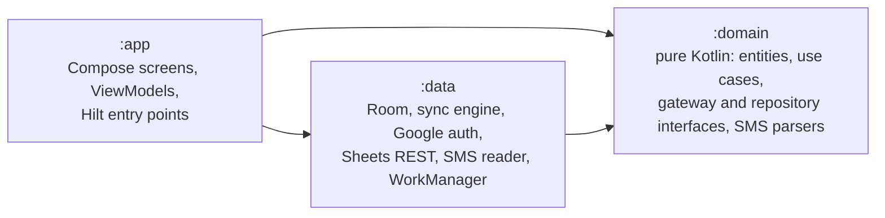
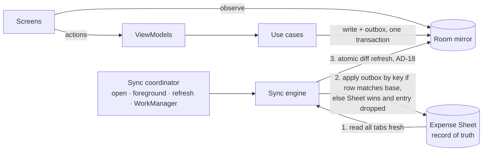
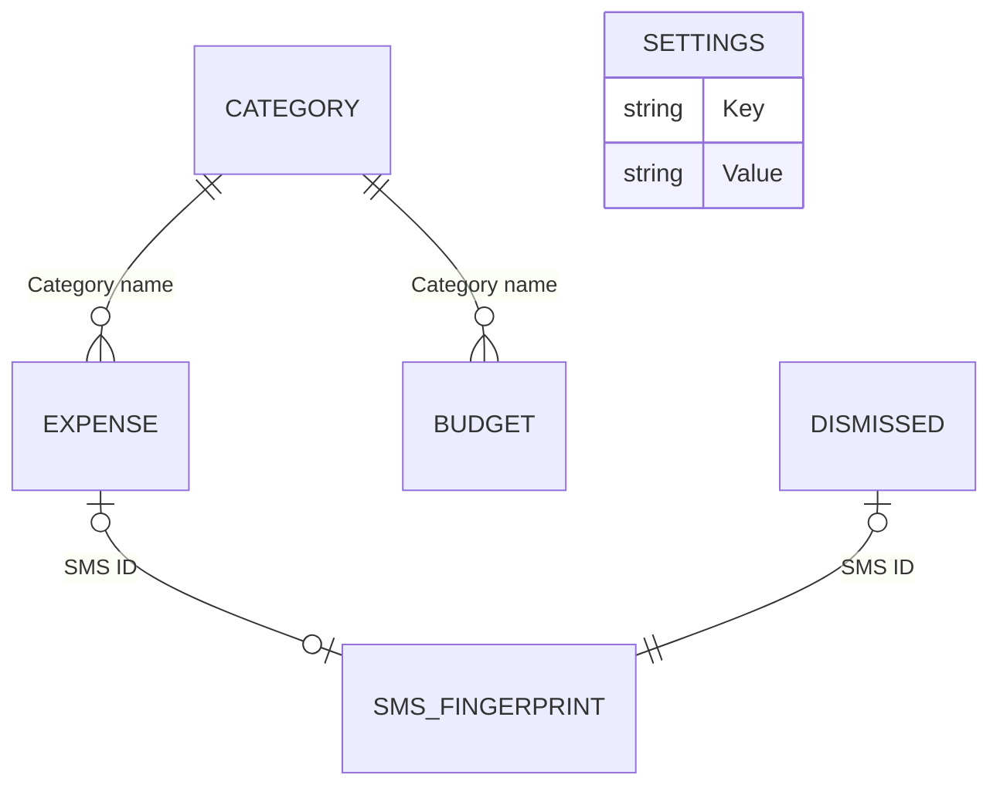
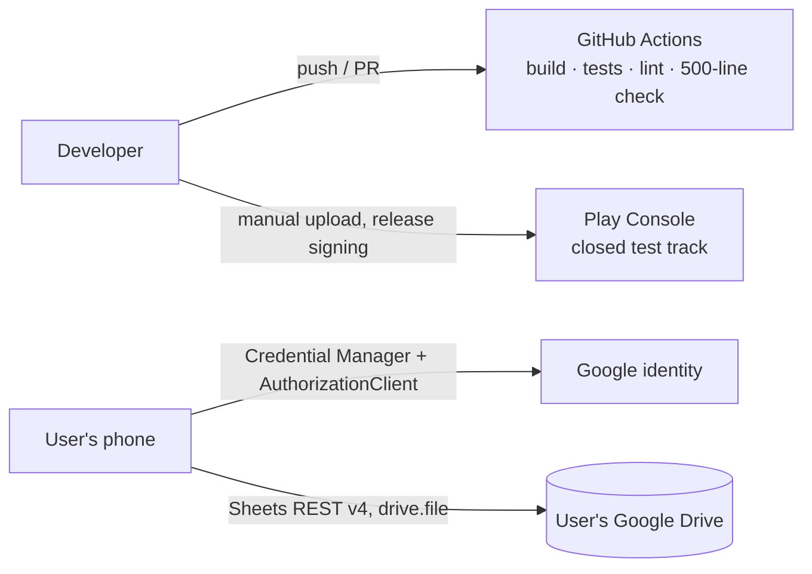

# Architecture Spine: Expense Tracker

## Design Paradigm

Clean Architecture split across three Gradle modules. Dependencies point inward only. Inside each module, code is grouped by feature.



`:app` depends on `:data` only to install Hilt bindings. `:app` code calls `:domain` types and never `:data` types.

## Invariants & Rules

### AD-1: Three-module Clean Architecture [ADOPTED]
- **Binds:** all
- **Prevents:** UI or Android code leaking into business logic, and business rules duplicated across screens.
- **Rule:** `:domain` is a pure Kotlin/JVM module with no Android, Room, Retrofit or Google dependency; its only annotation dependency is `javax.inject`. `:data` and `:app` depend on `:domain`. `:domain` depends on nothing in the project.

### AD-2: Feature packages, connected through domain interfaces [ADOPTED]
- **Binds:** all
- **Prevents:** features reaching into each other's internals, which would block a later split into `:feature:*` modules.
- **Rule:** each module has one package per feature: `account`, `expense`, `category`, `budget`, `inbox`, `sync`, `analytics`, `settings`. Code in one feature may use another feature only through that feature's public `:domain` interfaces and models.

### AD-3: Room is the local mirror the UI reads; every change goes through an outbox [ADOPTED]
- **Binds:** FR-3 to FR-9, FR-16 to FR-23, NFR-4, NFR-6
- **Prevents:** screens reading Google Sheets directly, offline changes getting lost, and changes to some tabs having no path to the Sheet.
- **Rule:** every screen reads data only from Room, via `:domain` repository interfaces that return `Flow`. Every local change to any tab is written to Room and appended to the outbox in the same Room transaction. The outbox entry types are a closed set: `UpsertExpense`, `DeleteExpense`, `UpsertCategory`, `DeleteCategory(name, reassignTo)`, `UpsertBudget(month, category)`, `AddDismissal(fingerprint)` and `UpsertSetting(key)`. Each entry is keyed by its tab's row key (AD-7). Pending Sync means only that an outbox entry exists for that row; there is no `synced` column.

### AD-4: The sync engine is the only writer to the Expense Sheet, and the Sheet wins [ADOPTED]
- **Binds:** FR-2, FR-5 to FR-9, FR-16 to FR-19, FR-22, FR-23
- **Prevents:** a pending in-app edit overwriting a newer hand edit, writes hitting the wrong row after a sort, and retries doubling rows.
- **Rule:** only the `sync` feature in `:data` calls `ExpenseSheetGateway`. Each outbox entry stores its base: the row's mapped values as last pulled, or "absent". A sync run:
  1. Reads every tab fresh.
  2. For each outbox entry in order, finds the row by its key in that read, never by row index. If the row differs from the base, the Sheet wins and the entry is dropped. Otherwise the entry is applied idempotently: a create whose key already exists becomes an update, and a delete of a missing key does nothing. Writes touch only mapped cells. An entry leaves the outbox only after the API confirms the write.
  3. Refreshes the mirror (AD-18).

### AD-5: Every Expense has a UUID identity [ADOPTED]
- **Binds:** FR-3, FR-5, FR-6, FR-8, FR-9, FR-15
- **Prevents:** IDs colliding after a reinstall, and hand-typed rows overwriting each other. Today an unparseable ID becomes `1`.
- **Rule:** an Expense ID is a random lowercase UUID string, created by the use case that creates the Expense and stored in the Sheet's `ID` column. During a pull:
  - A row with a blank ID gets a new UUID, written back to the Sheet.
  - Rows that share an ID and have identical mapped values are retry duplicates; all but the first are deleted.
  - Rows that share an ID but differ: the first in sheet order keeps the ID, each later row gets a new UUID, and its `SMS ID` is cleared. Both are written back.

### AD-6: Money is a whole number of paise [ADOPTED]
- **Binds:** FR-3, FR-11, FR-15, FR-18 to FR-22
- **Prevents:** floating-point drift in totals and in budget comparisons.
- **Rule:** amounts are `Long` minor units (paise) in `:domain` and Room. Only two places convert to and from decimal rupees: the Sheet mapping in `:data` and the formatter in `:app`. No `Double` amount appears in `:domain`.

### AD-7: The Expense Sheet layout and row parsing are a contract [ADOPTED]
- **Binds:** FR-2, FR-8, FR-16 to FR-19, FR-22, FR-23
- **Prevents:** the app, the sync engine and hand edits disagreeing on tabs, columns, keys or value formats.
- **Rule:** the Expense Sheet has exactly these tabs, header names and row keys:

  | Tab | Headers | Row key |
  | --- | --- | --- |
  | Expenses | `ID`, `Date`, `Amount`, `Category`, `Description`, `Source`, `SMS ID` | `ID` |
  | Categories | `Name`, `Color`, `Icon` | `Name` |
  | Budgets | `Month`, `Category`, `Amount` | (`Month`, `Category`) |
  | Dismissed | `SMS ID`, `Dismissed On` | `SMS ID` |
  | Settings | `Key`, `Value` | `Key` |

  - **Columns:** sync maps columns by header name, never by position. It preserves unknown columns and their values, and adds any missing required tab or header.
  - **Hand-typed values:** amounts accept `₹`, thousands separators and decimals. Category names match trimmed and case-folded.
  - **Unknown Categories:** a Category referenced on a pull but missing from Categories is added there.
  - **Invalid rows** are skipped, left untouched and counted in the sync result.
  - **Source:** a blank Source always becomes `User`. App edits never change an existing Source.
  - **Value modes:** `Date` is written with `valueInputOption=USER_ENTERED`. Reads use `UNFORMATTED_VALUE` with serial-number dates, and also accept date text.

### AD-8: Budgets are stored sparse and resolved by date [ADOPTED]
- **Binds:** FR-18, FR-19, FR-20
- **Prevents:** a missed or duplicated month-start copy, and two places computing "this month's budget" differently.
- **Rule:** a Budgets row is written only when the User sets or changes a Budget. A Category's Budget for month M is the row for that Category with the greatest `Month` that is less than or equal to M. Only the `:domain` use case `GetEffectiveBudget` computes this, and nothing runs on the 1st of the month.

### AD-9: Categories are referenced by name [ADOPTED]
- **Binds:** FR-17, FR-18, FR-20, FR-21
- **Prevents:** a hidden ID scheme that makes the Sheet unreadable, Expenses left pointing at a deleted Category, and deleted defaults coming back.
- **Rule:** an Expense and a Budget refer to their Category by name. The unique key is the trimmed, case-folded name, and there is no Category ID. Deleting a Category is one `DeleteCategory(name, reassignTo)` outbox entry. At push time it rewrites every matching Expense row in the fresh read to `reassignTo` (the base check is skipped for those rows), deletes that Category's Budgets rows, then deletes the Category row. Default Categories are written only when the sync engine creates a new Expense Sheet.

### AD-10: Sign-in and Google access [ADOPTED]
- **Binds:** FR-1, FR-2, NFR-2, NFR-5
- **Prevents:** broad sensitive scopes, secrets on the device, the blocked custom-scheme OAuth redirect, and a background job stuck on a consent prompt.
- **Rule:**
  - **Sign-in** uses Credential Manager (Sign in with Google).
  - **Drive and Sheets access** uses `AuthorizationClient` with the `drive.file` scope only, targeted at the signed-in account with `setAccount`.
  - **Tokens:** access tokens are short-lived and held in memory. On HTTP 401 the app calls `clearToken` and retries `authorize()` once. No refresh token, client secret or OAuth deep link exists.
  - **Consent:** when authorization needs the User's consent, background work returns a `NeedsUserConsent` failure, and the next foreground sync shows the prompt.
  - **OAuth clients:** every client, debug and release, belongs to one Google Cloud project.

### AD-11: Google code sits behind domain gateways [ADOPTED]
- **Binds:** FR-1, FR-2, FR-7 to FR-9
- **Prevents:** Google SDK or REST types spreading through the app, and two ways of finding the Expense Sheet.
- **Rule:**
  - **Interfaces:** `:domain` defines `AccountGateway` (the signed-in user, get access, sign out) and `ExpenseSheetGateway` (find or create the Expense Sheet, read tabs, write rows by key). Only `:data` implements them, and no Google type appears in a `:domain` signature.
  - **Finding the Sheet:** "find" means a Drive `files.list` over spreadsheets that carry the `appProperties` marker `expenseTracker=v1`, with `trashed=false`. When several match, the oldest `createdTime` wins.
  - **Creating the Sheet** sets that marker, the tabs from AD-7 and the default Categories.

### AD-12: SMS reading and parsing are split [ADOPTED]
- **Binds:** FR-10 to FR-14
- **Prevents:** Android SMS code mixed into the parsing logic, and one parser that grows with every bank.
- **Rule:** `SmsSource` (a `:domain` interface, implemented in `:data` over the SMS content provider) returns the raw SMS for one calendar day. `BankSmsParser` (a `:domain` interface) turns one SMS into a `DebitCandidate` or nothing. The implementations are one class per bank plus `GenericDebitParser`, all in `:domain`. `ParserRegistry` chooses by sender and falls back to `GenericDebitParser`. Adding a bank means adding a class and registering it, without editing another parser.

### AD-13: SMS fingerprints, with raw text kept on the phone [ADOPTED]
- **Binds:** FR-12, FR-15, FR-16, NFR-1
- **Prevents:** duplicate Inbox Items, a handled SMS coming back (including after its Expense is deleted), and SMS text reaching the Sheet, disk or logs.
- **Rule:**
  - **Fingerprint format:** frozen. `ref:<bank>:<reference>:<amountPaise>` when a Transaction Reference is present, otherwise `h:<sha256 of sender, timestamp and body>`.
  - **Inbox** shows at most one Inbox Item per fingerprint, and hides any fingerprint found in an Expense's `SMS ID` or in Dismissed.
  - **Add** writes the fingerprint to the Expense's `SMS ID`.
  - **Dismiss** appends `AddDismissal`, which does nothing if the fingerprint is already present. The app never edits Dismissed rows.
  - **Deleting an SMS-sourced Expense** appends its fingerprint to Dismissed in the same transaction. A pull copies any `SMS ID` whose Expense row is gone into Dismissed.
  - **Raw SMS text** exists only in memory while Inbox is open. It never goes into Room, the Sheet, the outbox, logs, saved state or navigation arguments; screens pass only the fingerprint.

### AD-14: Sync triggers [ADOPTED]
- **Binds:** FR-7, FR-8, NFR-4
- **Prevents:** screens starting their own ad-hoc syncs, and overlapping sync runs.
- **Rule:** a sync starts on app open, on return to the foreground, on pull-to-refresh, and through a WorkManager job that runs when the outbox is non-empty. That job is unique work with `NetworkType.CONNECTED`, `ExistingWorkPolicy.KEEP` and exponential backoff. A single sync coordinator in `:data` runs at most one sync at a time and coalesces overlapping requests.

### AD-15: MVVM with unidirectional data flow [ADOPTED]
- **Binds:** all screens
- **Prevents:** screens holding their own copies of data, and ViewModels reaching into data sources.
- **Rule:** each screen has one ViewModel, which exposes one immutable `UiState` as a `StateFlow` and public functions for user actions. A ViewModel depends only on `:domain` use cases. Use cases depend only on `:domain` interfaces (repositories and gateways), which is where tests substitute fakes. Composables hold only transient UI state, such as text being typed or whether a dialog is open.

### AD-16: Dependency injection with Hilt [ADOPTED]
- **Binds:** all
- **Prevents:** hand wiring in `MainActivity`, and tests that can't swap implementations.
- **Rule:** Hilt wires every dependency. `:domain` classes use only `javax.inject.Inject`. Hilt modules that bind gateway and repository implementations live in `:data`. Tests replace bindings with fakes. No class creates its own collaborators.

### AD-17: No file over 500 lines [ADOPTED]
- **Binds:** all
- **Prevents:** god files like today's 1,940-line `MainActivity.kt`.
- **Rule:** a Gradle check fails the build when any `.kt` file in any module exceeds 500 lines, and CI runs it. Each file holds one screen, one use case, one parser or one gateway implementation. Shared Compose widgets go in each feature's `components/` package.

### AD-18: Mirror refresh is one atomic diff [ADOPTED]
- **Binds:** FR-3 to FR-9, FR-20, NFR-4
- **Prevents:** a sync erasing an Expense saved during the run, and screens flashing empty or firing false budget alerts.
- **Rule:** the mirror is refreshed only after every tab has been read successfully. The refresh is one Room transaction that reads the outbox inside that transaction, merges the Sheet's contents with still-pending entries, and applies the result as a diff. A table is never cleared and refilled. Local writes serialize with the refresh on Room's transaction lock.

### AD-19: Dates have no time zone after creation [ADOPTED]
- **Binds:** FR-3, FR-11, FR-15, FR-18 to FR-21
- **Prevents:** Expenses shifting when the phone changes time zone, and different parts of the app putting the same Expense in different months.
- **Rule:** an Expense date is a minute-precision `LocalDateTime` in `:domain` and Room, never converted again after creation. An SMS timestamp is converted once, in the device's zone, when its Inbox Item is built. A Budget Month is `YearMonth.from(date)`, computed only in `:domain`. "Now" comes from an injected `Clock`.

### AD-20: Session lifecycle [ADOPTED]
- **Binds:** FR-1, FR-2, NFR-4, NFR-5
- **Prevents:** an offline cold start losing who's signed in, and one account's pending changes reaching another account's Sheet.
- **Rule:**
  - **Stored locally:** the signed-in account ID and email and the Expense Sheet ID, with no secrets. The app starts offline from this.
  - **Sign-out:** if the outbox is non-empty, the User is warned first. Then all sync work is cancelled and all local data is erased: the Room mirror, the outbox and the stored session.
  - **Missing Sheet:** if the Expense Sheet is gone during a session, the next sync follows AD-11's find-or-create.
  - **Settings** (Currency and display name) live in the Settings tab and change only through `UpsertSetting`.

## Consistency Conventions

| Concern | Convention |
| --- | --- |
| Naming | Use cases are classes named `VerbNounUseCase` (`AddExpenseUseCase`), with one public `operator fun invoke`. Interfaces to outside systems are `*Gateway`, interfaces to stored data are `*Repository`. Screen state is `<Screen>UiState`. Glossary terms from the PRD are used verbatim in type names (`InboxItem`, `ExpenseSheet`, `BudgetMonth`). |
| IDs | Expense IDs are lowercase UUID strings (AD-5). SMS fingerprints are strings (AD-13). Categories are keyed by name (AD-9). |
| Dates and months | `LocalDateTime` at minute precision (AD-19). The Sheet's `Date` is shown as `yyyy-MM-dd HH:mm`. Budget months are `yyyy-MM` (`java.time.YearMonth`). |
| Money | `Long` minor units (1/100) in `:domain` and Room. Decimals only in the Sheet mapping and the UI formatter (AD-6). Currency affects formatting only, and v1 offers only currencies with two decimal places. |
| Errors | `:domain` use cases return a sealed result type (success or a named failure) instead of throwing to callers. Exceptions from Google, Room or the network are caught in `:data` and mapped to domain failures. ViewModels turn failures into `UiState` messages. |
| Logging | Never log SMS content, access tokens, email addresses or amounts tied to payees. |
| Config | No secret is committed. OAuth client IDs are configured per build type. Nothing in `.env` is required for v1. |
| Testing | The sync engine has a test matrix covering each outbox type against row unchanged, changed in Sheet, deleted in Sheet, duplicated and hand-typed. Parsers include negative samples (OTPs, credits, promotional SMS). Most tests are `:domain` JVM unit tests, covering parsers (each with masked real SMS samples), dedup, budget resolution and month rollover. The sync engine is tested against a fake `ExpenseSheetGateway`. `:app` uses Compose UI tests via `testTag`s and Roborazzi screenshots for key screens. |

## Stack

Versions live in `gradle/libs.versions.toml`. These are the pins verified on 2026-10-08.

| Name | Version |
| --- | --- |
| Android Gradle Plugin | 9.4.1 |
| Kotlin (Android and JVM plugins) | 2.4.21 |
| KSP | 2.3.12 |
| compileSdk / targetSdk / minSdk | 36 / 36 / 24 |
| Java target | 11 |
| Compose BOM | 2026.09.00 |
| AndroidX Lifecycle | 2.11.0 |
| Hilt (`com.google.dagger:hilt-android`, Gradle plugin) | 2.60.1 |
| `androidx.hilt:hilt-navigation-compose`, `hilt-work` | 1.4.0 |
| Navigation Compose | 2.10.2 |
| Room | 2.8.5 |
| WorkManager (`work-runtime-ktx`) | 2.12.0 |
| Credential Manager (`androidx.credentials`) | 1.6.0 |
| Google ID (`googleid`) | 1.2.1 |
| `play-services-auth` (AuthorizationClient) | 22.0.0 |
| Retrofit | 3.0.0 |
| OkHttp (via `okhttp-bom`, with logging-interceptor) | 5.5.0 |
| Moshi | 1.15.2 |
| Robolectric / Roborazzi | 4.17 / 1.76.0 |
| Google Sheets API / Drive API | REST v4 / REST v3 |

## Structural Seed

```text
expense-tracker/
  domain/   # pure Kotlin: account/ expense/ category/ budget/ inbox/ sync/ analytics/ settings/
  data/     # Room DB and outbox, sync engine and coordinator, Google gateways, SmsSource, Hilt modules, WorkManager worker
  app/      # MainActivity (navigation host only), one package per feature: screens, ViewModels, components/
```







### Operations

- **Identity:** `applicationId` and `namespace` are `com.shashi.expensetracker`, set before any OAuth client is created. The ID can never change after the first Play release.
- **OAuth clients:** debug and release builds each have their own Google OAuth client, both in one Google Cloud project. The release client is registered with the Play App Signing SHA-1, not the upload key's. The debug client lists the debug signing SHA-1s in use.
- **Environments:** there is no staging Sheet; testers use a test Google account.
- **Release build:** R8 minification is enabled, with keep rules for Moshi and Retrofit models. Releases go to the Play Console closed test track by manual upload.
- **Manifest:** `android:allowBackup="false"`, so Auto Backup never copies the database or outbox. Declare `READ_SMS` and remove `GET_ACCOUNTS`.
- **CI:** GitHub Actions runs the build, unit tests, lint and the 500-line check on every push and PR.

## Capability → Architecture Map

| Capability / Area | Lives in | Governed by |
| --- | --- | --- |
| FR-1, FR-2 sign-in and Expense Sheet | `account` (`:domain`, `:data`, `:app`) | AD-10, AD-11, AD-20, AD-7 |
| FR-3 to FR-6 Expenses | `expense` | AD-3, AD-5, AD-6 |
| FR-7 to FR-9 sync and offline | `sync` (`:data`) | AD-3, AD-4, AD-14, AD-18 |
| FR-10 to FR-16 SMS Inbox | `inbox` | AD-12, AD-13, AD-19 |
| FR-17 Categories | `category` | AD-9 |
| FR-18 to FR-20 Budgets and Amount Left | `budget` | AD-8, AD-6 |
| FR-21 analytics | `analytics` | AD-3, AD-6 |
| FR-22, FR-23 settings | `settings` | AD-7 (Settings tab), AD-20, AD-6 |
| NFR-1 privacy | `inbox`, logging, manifest | AD-13, Logging convention, Operations (backup off) |
| NFR-3 Play compliance | release process | AD-10 (`drive.file`), AD-12 (on-demand `READ_SMS` only) |

## Deferred


- **Running on two phones at once with one Expense Sheet** (PRD OQ3): AD-4's base check and AD-11's oldest-Sheet rule keep both phones convergent. Simultaneous edits to the same row resolve to whichever write reaches the Sheet first.
- **Undetected bank SMS** (PRD OQ2): beyond `GenericDebitParser`, there's no reporting flow until after a month of real use.
- **Room 3, Navigation 3, detekt 2.0:** revisit when the need arises or, for detekt, when 2.0 is stable. None changes an AD.
- **Automated Play publishing:** manual uploads for v1.
- **v2 "Analyze my finances" LLM and other countries' banks:** v2 planning. The other countries plug into AD-12 as more parsers.
- **Room schema migrations:** v1 starts a new schema, with no migration from today's local database or the legacy `Sheet1` layout. From the first public release, migrations are required and must never drop a non-empty outbox.
- **Sheets made outside the app:** under `drive.file` the app sees only files it created. Importing a hand-made sheet is out of scope.
- **Architecture tests** (for example Konsist) for AD-2 and AD-15: add once the module split exists. Until then the Gradle module boundaries carry AD-1.
- **Observability:** no crash reporting or analytics SDK in v1 (PRD NFR-1). Diagnostics come from local logs only.
