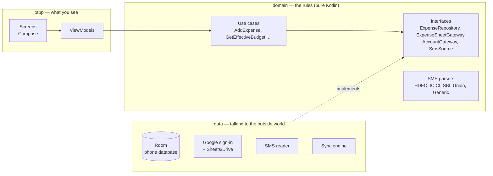
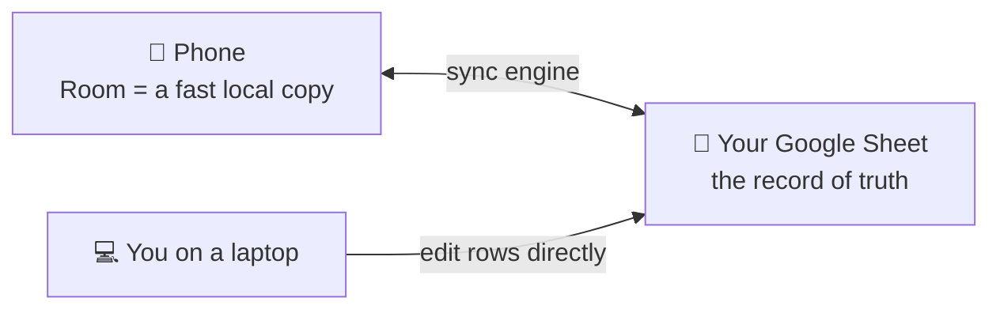
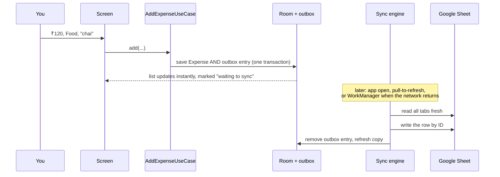
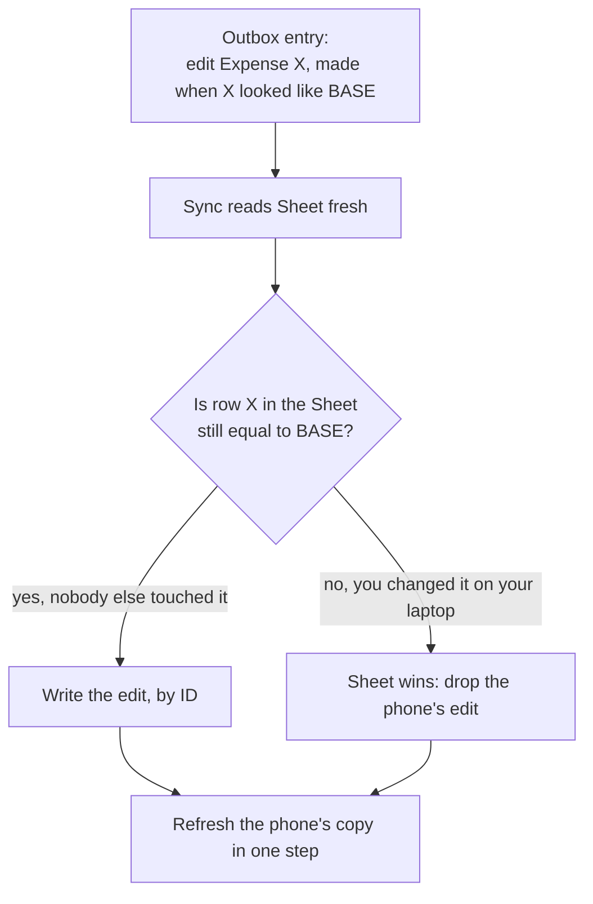
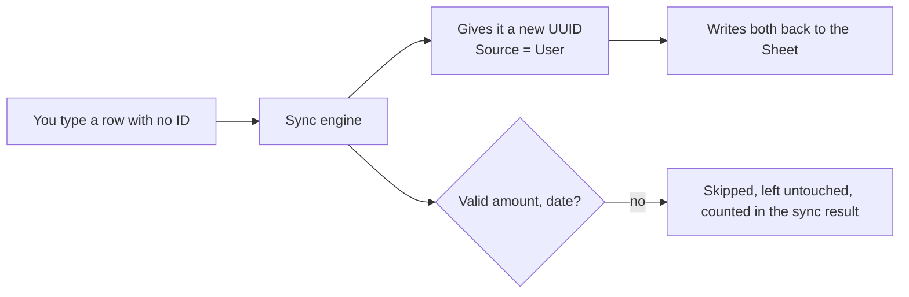
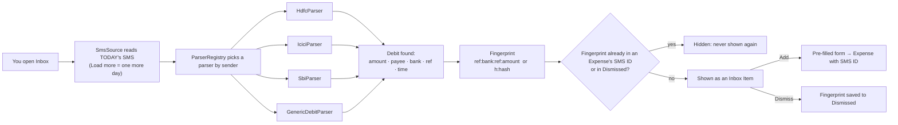
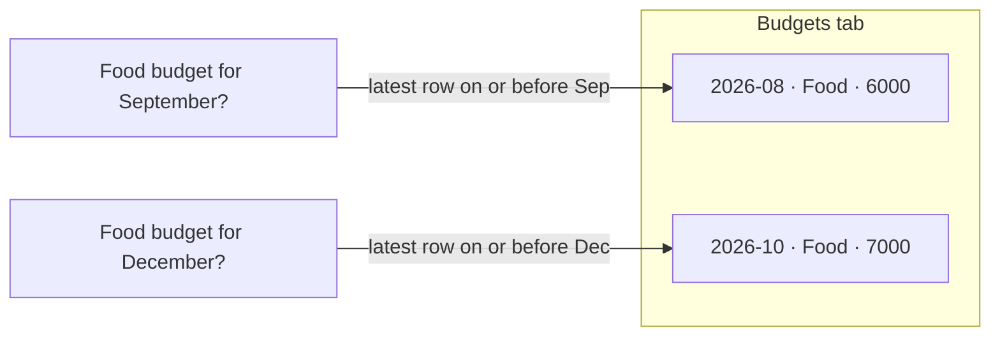
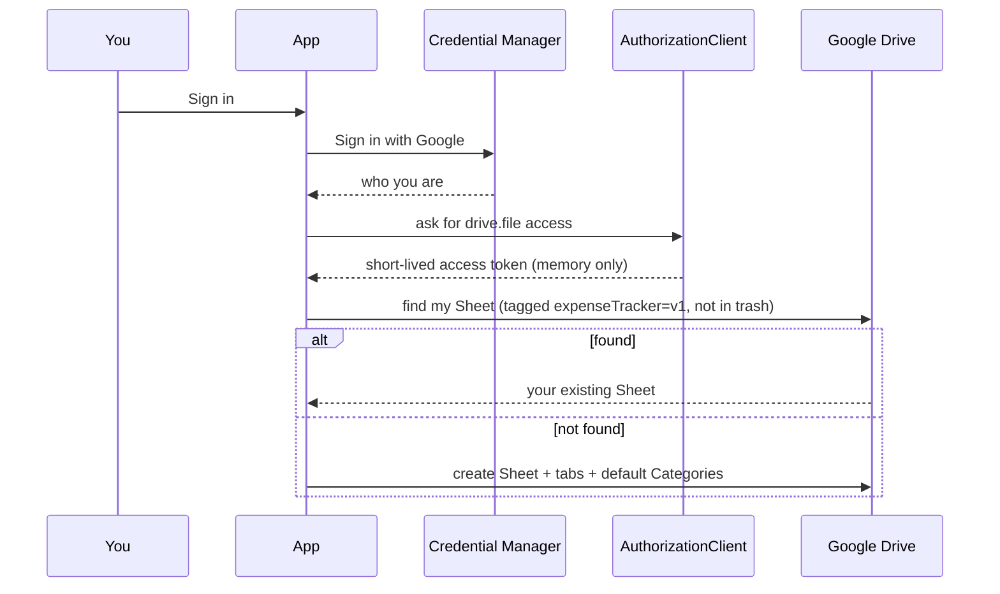
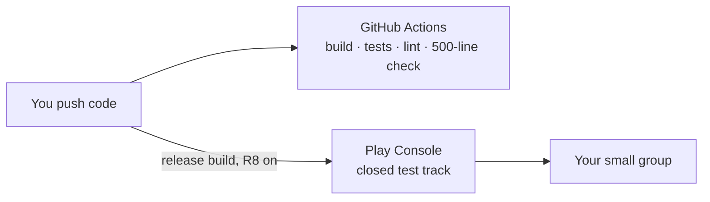

# Expense Tracker: Architecture Walkthrough

A guided tour of how the app is designed, one picture at a time. The binding rules are in `architecture-expense-tracker.md` (AD-1 to AD-20). This walkthrough explains them in plain words, and when the two disagree, the spine wins.

---

## 1. The big picture: three layers, arrows point inward

**What to remember:**
- **`:domain` is the heart.** It holds all the business rules and knows nothing about Android, Google or databases. That's why its tests run in milliseconds.
- **`:data` plugs in the real world.** Room, Google and SMS live here, each behind an interface from `:domain`.
- **`:app` only shows things and passes on taps.**
- **The compiler enforces the direction.** `:domain` can't import Room or Google even by accident (AD-1).
- **Inside each layer, code is grouped by feature** (`expense`, `budget`, `inbox`, ...), so one feature could later become its own module (AD-2).

---

## 2. Where your data lives

- **The Google Sheet is the truth.** The phone keeps a copy so everything works offline and loads instantly (AD-3).
- **Screens never talk to Google.** They read only the local copy.
- **Only the sync engine touches the Sheet.** No other code writes to it, so no two parts of the app can disagree about it (AD-4).

**The Sheet's tabs (AD-7):**

| Tab | What's in it | Each row is identified by |
|---|---|---|
| Expenses | ID, Date, Amount, Category, Description, Source, SMS ID | `ID` (a UUID) |
| Categories | Name, Color, Icon | `Name` |
| Budgets | Month, Category, Amount | Month + Category |
| Dismissed | SMS ID, Dismissed On | `SMS ID` |
| Settings | Key, Value (Currency, display name) | `Key` |

You can reorder columns, add your own columns, or type `₹1,200`. Sync matches columns by **header name** and understands common formats.

---

## 3. Adding an expense, offline or online

- **The outbox** is a to-do list of changes not yet in the Sheet. Every kind of change goes through it: Expenses, Categories, Budgets, Dismissed SMS and Settings (AD-3).
- **"Waiting to sync"** simply means an outbox entry exists for that row.
- **WorkManager** pushes the outbox once there's a network connection, even if you've closed the app (AD-14).

---

## 4. When you and the app both change the same row

- **Each pending change remembers what the row looked like** when you made it, its "base". If the Sheet no longer matches, your Sheet edit wins (AD-4).
- **Rows are always found by ID**, never by position, so sorting the Sheet can't make a write hit the wrong row.
- **Retries are safe.** Re-sending a write can't create a duplicate.
- **The phone's copy is updated in one atomic step**, so screens never flash empty and an expense you're adding mid-sync can't be wiped (AD-18).

---

## 5. Rows you type straight into the Sheet

- **Unknown Categories** you type are added to the Categories tab automatically.
- **Copied rows** with the same ID are sorted out. Exact duplicates are removed, and changed copies get new IDs (AD-5).

---

## 6. The SMS Inbox

- **Adding a new bank** means adding one small parser class. Nothing else changes (AD-12).
- **The fingerprint** is what makes "never show it again" work, even on a new phone, because it's stored in the Sheet (AD-13).
- **Deleting an expense that came from an SMS** puts that SMS in Dismissed, so it doesn't come back.
- **Raw SMS text never leaves memory.** It's not saved to the database, the Sheet, logs or backups.

---

## 7. Budgets: write only on change

- **A row is written only when you set or change a budget.** Every later month uses the latest earlier row, so "copy last month's budget" happens without any job on the 1st (AD-8).
- **Months are fixed when the expense is created.** A 23:30 expense on the 31st stays in that month, even if you travel to another time zone (AD-19).

---

## 8. Signing in and Google access

- **`drive.file`** means the app can see **only the files it created**. That's the most private option, and it eases Google's verification (AD-10).
- **No passwords, secrets or long-lived tokens are stored on the phone.** When a token expires, the app quietly asks for a new one.
- **Signing out** warns you if changes haven't synced yet, then erases everything local. The Sheet still has it all (AD-20).

---

## 9. How the code stays clean

| Rule | What it means for you |
|---|---|
| **MVVM** (AD-15) | One ViewModel per screen, one `UiState`. Screens only display state and pass on taps |
| **Hilt** (AD-16) | Classes ask for interfaces, and Hilt hands them the real ones (or fakes in tests) |
| **500-line limit** (AD-17) | A Gradle check fails the build if any `.kt` file goes over 500 lines |
| **Money as paise** (AD-6) | `Long` whole numbers, so 0.1 + 0.2 rounding errors are impossible |
| **Errors** | Use cases return success or a named failure. Screens show a message instead of crashing |

**Testing pyramid:**
- **Most tests, all fast:** `:domain` unit tests covering parsers with real masked SMS, dedup, budget math and month boundaries.
- **Sync engine:** tested against a fake Sheet, through a matrix of "unchanged / changed / deleted / duplicated / hand-typed" rows.
- **A few UI tests:** Compose tests plus Roborazzi screenshots of key screens.

---

## 10. From code to your phone

- **App ID:** `com.shashi.expensetracker`. It's permanent after the first release.
- **OAuth clients:** separate ones for debug and release, both in **one** Google Cloud project.
- **Backups off:** Android won't copy the phone database anywhere. Your Sheet is the backup.
